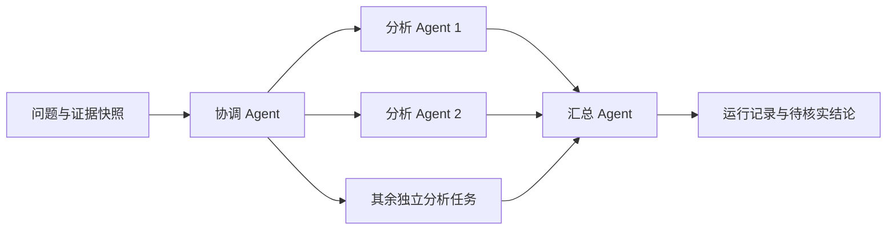

# Agent 蜂群：协作分析逆向证据

蜂群以一个问题和一份已导出的证据为输入。协调 Agent 把问题拆成互相独立的分析任务，执行 Agent 并发分析同一份证据，汇总 Agent 再整理各项结果、冲突和缺口。



首版复用项目已有的 OMP CLI 调用。每次调用在独立临时目录中启动，关闭工具、skills、rules 和 extensions；Agent 只分析提供的证据文本。所有角色使用当前 OMP 配置的模型，不修改宿主配置。

## 运行

先安装本分支的 Python 包，并确保 OMP CLI 能在 PATH 中找到。证据文件可来自 IDA 快照、函数列表、导入/字符串摘要或已保存的反编译文本。

Windows 上，PATH 实际选中的 `omp` 不得是 `.cmd`/`.bat` 启动器；请把原生 `omp.exe` 放到更靠前的位置。批处理启动器会被拒绝，失败原因保存在 Agent 记录中；蜂群仍保留现有的失败报告和退出码 5。

```powershell
python -m pip install -e ".[test]"
reverse-skill-swarm --goal "分析样本的网络通信和可疑解密线索" --context evidence.txt --output runs/swarm-001 --max-calls 6 --max-tasks 4 --max-parallel 2 --timeout 120 --json
```

也可直接执行源码入口：

```powershell
python -m reverse_skill.swarm_cli --help
```

`--max-calls` 必须显式提供，限制逻辑调用尝试。协调和汇总各预留一次，最多安排 `min(max-tasks, max-calls - 2)` 个执行任务。没有自动重试和自动追加任务；OMP/provider 自身可能重试，因此此值不是物理 HTTP 请求数或 Token/费用上限。

`--max-parallel` 限制同时运行的执行 Agent；协调和汇总串行进行。`--timeout` 是每次 OMP 调用的模型时限，外层进程另有现有的 10 秒退出余量。

## 结果与失败

输出目录必须是新目录，已有目录会拒绝覆盖。每次运行保存：

- `context.txt`：按 UTF-8 原始字节保存的同一份证据快照，保留换行；文件的 SHA-256 记录在运行报告中。
- `agents/coordinator.json`、`agents/worker-*.json`、`agents/summarizer.json`：每次调用的提示词、原始返回和调用错误。
- `run.json`：实际逻辑调用尝试数、各任务结果/失败、汇总和执行状态。结果按协调者的任务顺序保存。

执行 Agent 失败时，其他任务继续，已取得的结果保留，汇总能看到失败信息。协调输出格式不合法时不启动执行 Agent；汇总失败时保留此前分析。CLI 对失败或部分完成返回非零退出码，并给出 `run.json` 位置。

`execution_status=succeeded` 表示这轮调用和输出格式检查成功，`analysis_status` 始终为 `advisory`。模型分析和引用尚需核对原始证据；该状态不代表已完成真实目标验证、发现漏洞、运行 Frida 或修改 IDA 数据库。

首版没有接入自动 IDA/Frida 工具执行、跨 Agent 数据库写操作、在线扩展任务、失败重试或断点恢复。Ctrl+C 会取消尚未启动的任务，等待已启动调用结束并保留结果和取消状态；已启动的调用仍受现有逐次超时约束。

## 开发验证

`python -m pytest tests/test_swarm.py -q` 覆盖实际线程并发、调用预算、坏计划、部分失败、原始记录、已有输出保护、UTF-8 混合换行快照、中断时取消排队任务并保存已运行结果，以及通过真实替身子进程的 CLI/标准输入路径。测试不连接模型服务。

本分支的首次验证记录：

| 结论 | 验证方式 | 结果与局限 |
|---|---|---|
| Python 回归通过 | `python -m pytest -q --tb=short` | 退出码 0，250 passed、5 skipped，19.13 秒；跳过项未计为通过。 |
| 安装后的入口可用 | 临时隔离 venv 中执行 `pip install --no-deps --no-build-isolation -e .`，再执行安装生成的 `reverse-skill-swarm --help` | 构建、安装及命令执行退出码均为 0；未替换宿主的 Python 包或模型配置。 |
| 代码语法与 diff 检查通过 | `python -m compileall -q reverse_skill/swarm.py reverse_skill/swarm_cli.py`、`git diff --check` | 退出码均为 0。 |
| 真实模型和真实目标未验证 | 本次验证使用内存替身及 Python 替身进程 | 没有通过此蜂群发送真实模型请求，没有操作真实 IDA/Frida 目标。 |

独立复核后修正了 Windows 换行导致证据文件与哈希不一致、中断后继续调用排队任务两项问题。初始新增回归在修正前均失败（3 failed）；最终聚焦测试 29 passed（4.42 秒），完整回归 255 passed、5 skipped（22.69 秒），退出码 0。中断回归覆盖已运行调用成功/失败、提交前取消、已入队但尚未返回 future 时中断；未参与实现的 Agent 只读复核并复跑 29 项测试通过。该验证仍未连接真实模型或目标。
